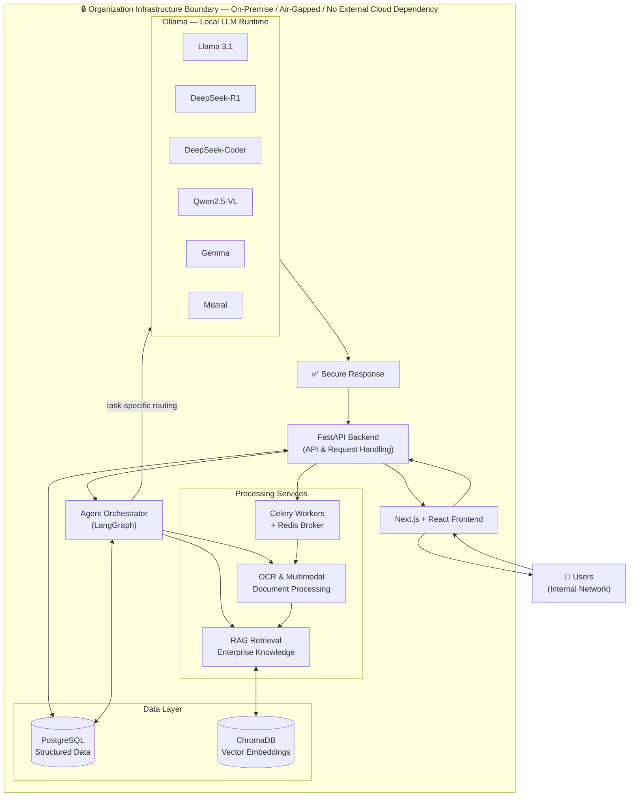
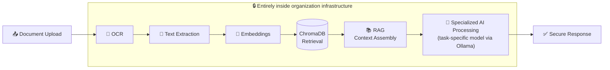
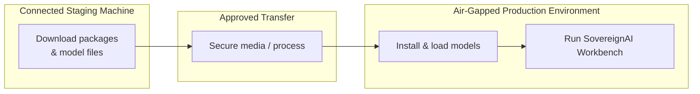

<div align="center">

# 🛡️ SovereignAI Workbench

### Sovereign On-Premise Agentic AI Workbench using Open-Weight Multimodal LLMs for Confidential Industrial Work

**"Secure AI. Zero Data Leakage. Maximum Productivity."**


</div>

> **SovereignAI Workbench** is a secure, fully on-premise, air-gapped Agentic AI platform for refineries, PSUs, defence-linked manufacturing units, government offices, and any organization whose information must never leave its own infrastructure.

> ⚠️ **Status note.** This README separates what is **proposed** (the SIH 2026 solution design) from what is **implemented**. Items marked `🟡 Proposed` or `🔧 Placeholder` must be updated by the team as development progresses. See [Implementation Status](#implementation-status).

---

## 📑 Table of Contents

1. [Project Overview](#1-project-overview)
2. [Project Badges](#2-project-badges)
3. [Smart India Hackathon 2026 Information](#3-smart-india-hackathon-2026-information)
4. [Problem Statement](#4-problem-statement)
5. [Proposed Solution](#5-proposed-solution)
6. [Key Features](#6-key-features)
7. [AI Models and Their Specialized Roles](#7-ai-models-and-their-specialized-roles)
8. [System Architecture](#8-system-architecture)
9. [AI Processing Workflow](#9-ai-processing-workflow)
10. [Technology Stack](#10-technology-stack)
11. [Project Directory Structure](#11-project-directory-structure)
12. [Installation and Setup](#12-installation-and-setup)
13. [Environment Configuration](#13-environment-configuration)
14. [Running the Application](#14-running-the-application)
15. [API Documentation](#15-api-documentation)
16. [Security and Data Privacy](#16-security-and-data-privacy)
17. [On-Premise and Air-Gapped Deployment](#17-on-premise-and-air-gapped-deployment)
18. [Feasibility and Viability](#18-feasibility-and-viability)
19. [Risks and Mitigation Strategies](#19-risks-and-mitigation-strategies)
20. [Real-World Use Cases](#20-real-world-use-cases)
21. [Expected Impact and Benefits](#21-expected-impact-and-benefits)
22. [Future Enhancements](#22-future-enhancements)
23. [Research Papers and References](#23-research-papers-and-references)
24. [Team Information](#24-team-information)
25. [Contribution Guidelines](#25-contribution-guidelines)
26. [License](#26-license)
27. [Contact and Acknowledgements](#27-contact-and-acknowledgements)

> The title and introduction above form section 1 of the required structure; the numbered sections below follow the same order.

---

## 1. Project Overview

Organizations that handle confidential information, such as refineries, PSUs, defence-linked manufacturers, and government offices, are often unable to use public cloud AI services because prompts, documents, and source code would leave their controlled environment.

**SovereignAI Workbench** addresses this by running the **entire AI stack inside the organization's own infrastructure**. All inference, retrieval, document processing, and storage occur on-premise, and the platform is designed to operate in an **air-gapped** environment with no dependency on external cloud services or external AI APIs.

### What it enables

| Capability | Description |
|---|---|
| 📄 Intelligent document analysis | Understand, summarize, and query internal documents |
| 🔍 OCR-based extraction | Convert scanned documents and images into machine-readable text |
| 💻 AI-powered coding assistance | Local code generation and review for internal teams |
| 🧠 Enterprise knowledge retrieval | Search internal knowledge with semantic retrieval |
| 🔗 Retrieval-Augmented Generation (RAG) | Ground model answers in the organization's own documents |
| 📝 Report generation | Draft structured reports from internal data and documents |
| 🖼️ Image and document understanding | Multimodal analysis of images, diagrams, and scanned pages |
| 🗂️ Secure knowledge management | Keep organizational knowledge inside the infrastructure boundary |
| 🎯 Task-specific AI processing | Dedicated open-weight models assigned to specialized tasks |

> **Primary objective:** confidential organizational information never leaves the organization's infrastructure.

---

## 2. Project Badges

Badges are displayed at the top of this README. Update the **License** badge once a license is chosen, and add build/test badges only when CI is actually configured.

---

## 3. Smart India Hackathon 2026 Information

| Field | Details |
|---|---|
| **Hackathon** | Smart India Hackathon (SIH) 2026 |
| **Problem Statement ID** | SIH26117 |
| **Theme** | Smart Automation |
| **PS Category** | Software |
| **Team Name** | SPECTREX |
| **Team ID** | 124750 |
| **Project Name** | SovereignAI Workbench |
| **Full Title** | Sovereign On-Premise Agentic AI Workbench using Open-Weight Multimodal LLMs for Confidential Industrial Work |
| **GitHub Repository** | `SovereignAI-Workbench` |

---

## 4. Problem Statement

Industrial and government organizations increasingly want the productivity gains of generative AI, but face several barriers:

- **Confidentiality:** Sensitive documents, designs, operational data, and source code cannot be shared with external AI providers.
- **Regulatory and security constraints:** Many environments are isolated or air-gapped by policy.
- **Fragmented knowledge:** Valuable information is spread across scanned documents, reports, manuals, and code, which makes it hard to search.
- **Generic tooling:** A single general-purpose model is rarely the best fit for coding, document reading, reasoning, and image understanding at once.
- **Manual effort:** Document review, report drafting, and knowledge lookup remain slow and labour-intensive.

> 🔧 *Placeholder:* Replace or extend this section with the exact wording of problem statement **SIH26117** from the official SIH portal and the team's idea-submission PDF.

---

## 5. Proposed Solution

SovereignAI Workbench is a **single on-premise workbench** that brings open-weight multimodal LLMs, a retrieval layer, OCR, and an agent orchestrator together behind one secure web interface.

1. **Users** interact through a web frontend hosted inside the organization's network.
2. A **FastAPI backend** authenticates requests and exposes the platform's services.
3. An **agent orchestrator (LangGraph)** routes each task through a defined workflow.
4. **Task-specific local models**, served by **Ollama**, handle specialized work (coding, reasoning, vision, general language tasks).
5. A **RAG pipeline** retrieves relevant internal knowledge from **ChromaDB**, while **PostgreSQL** stores structured application data.
6. **Celery and Redis** run long-running work such as OCR and embedding generation in the background.
7. Results return to the user as a **secure response**, with no external network calls.

### Task-specific model integration (not automatic model selection)

The platform **does not claim to automatically choose the best model** for a request. Instead, **different models are assigned to specialized tasks**, and the workflow for each task type is configured to use its assigned model. See [Section 7](#7-ai-models-and-their-specialized-roles).

---

## 6. Key Features

> Legend: 🟡 **Proposed**: part of the designed solution, not yet confirmed as implemented. ✅ **Implemented**: update this column only when a feature is working in the repository.

| # | Feature | Description | Status |
|---|---|---|---|
| 1 | Fully on-premise operation | All processing runs inside organizational infrastructure | 🟡 Proposed |
| 2 | Air-gapped deployment | No dependency on external cloud services or external AI APIs | 🟡 Proposed |
| 3 | Document analysis | Summarization and question answering over internal documents | 🟡 Proposed |
| 4 | OCR extraction | Text extraction from scanned documents and images | 🟡 Proposed |
| 5 | RAG-based knowledge retrieval | Answers grounded in internal documents via ChromaDB | 🟡 Proposed |
| 6 | Coding assistance | Local code generation and review using code-specialized models | 🟡 Proposed |
| 7 | Multimodal understanding | Image and document-page understanding using a vision-language model | 🟡 Proposed |
| 8 | Report generation | Structured report drafting from retrieved context | 🟡 Proposed |
| 9 | Agentic workflows | LangGraph-orchestrated multi-step task flows | 🟡 Proposed |
| 10 | Background processing | Asynchronous OCR/embedding jobs via Celery and Redis | 🟡 Proposed |
| 11 | Task-specific model assignment | Specialized open-weight models mapped to specific tasks | 🟡 Proposed |

### Comparison with cloud-hosted AI assistants

| Aspect | Typical cloud AI assistant | SovereignAI Workbench |
|---|---|---|
| Where data is processed | Provider's infrastructure | Organization's own infrastructure |
| External AI API calls | Required | None by design |
| Air-gapped operation | Not possible | Designed for it |
| Model control | Provider-controlled | Organization-controlled open-weight models |
| Knowledge grounding | Often requires uploading data | Retrieval from local ChromaDB |

---

## 7. AI Models and Their Specialized Roles

All models are **open-weight** and run locally through **Ollama**. Each is assigned to the kinds of tasks it is generally suited for.

| Model | Intended specialized role in this platform | Status |
|---|---|---|
| **Llama 3.1** | General-purpose language tasks: Q&A, summarization, report drafting | 🟡 Proposed |
| **DeepSeek-R1** | Reasoning-heavy tasks that benefit from step-by-step analysis | 🟡 Proposed |
| **DeepSeek-Coder** | Code generation, explanation, and review | 🟡 Proposed |
| **Qwen2.5-VL** | Multimodal tasks: image, scanned-page, and document understanding | 🟡 Proposed |
| **Gemma** | Lightweight language tasks where a smaller model is appropriate | 🟡 Proposed |
| **Mistral** | Efficient general-purpose language tasks | 🟡 Proposed |

> 🔧 *Placeholder:* Confirm the exact role assignment, model sizes, and quantization for each model against the team's final design. The table above is a proposed mapping.

**Important:** model-to-task assignment is **configured by task type**. The system does not automatically evaluate and pick the best model for each request.

---

## 8. System Architecture

All components inside the dashed boundary run within the organization's infrastructure. **There is no external cloud dependency.**



### Component responsibilities

| Component | Role |
|---|---|
| **Next.js / React** | User interface for chat, document upload, and results |
| **FastAPI** | Backend API layer: receives requests, validates input, coordinates services |
| **LangGraph** | Defines and runs agent workflows as explicit multi-step graphs |
| **Ollama** | Local runtime that loads and serves the open-weight LLMs |
| **PostgreSQL** | Relational store for **structured application data** (see below) |
| **ChromaDB** | Vector store for **document embeddings used in semantic retrieval** (see below) |
| **Celery** | Executes long-running background jobs (e.g., OCR, embedding generation) |
| **Redis** | Message broker that queues work for Celery |

### PostgreSQL vs. ChromaDB: two different jobs

| | **PostgreSQL** | **ChromaDB** |
|---|---|---|
| Type | Relational database | Vector database |
| Stores | Structured records such as users, roles, document metadata, job status, and audit/log data *(proposed schema)* | Embedding vectors of document chunks plus their metadata |
| Used for | Application state and exact, structured queries | Semantic similarity search for RAG |
| Answers | "Which documents did this user upload?" | "Which passages are most relevant to this question?" |

> 🔧 *Placeholder:* The exact PostgreSQL tables and ChromaDB collections are not defined here. Document them once the schema is finalized.

---

## 9. AI Processing Workflow

### Document-to-answer pipeline



### Step-by-step

| Step | What happens |
|---|---|
| 1. Document upload | A user uploads a document through the frontend; the backend accepts it |
| 2. OCR | Scanned pages or images are converted to text (run as a background job) |
| 3. Text extraction | Extracted text is cleaned and split into chunks |
| 4. Embeddings | Each chunk is converted into a vector embedding locally |
| 5. ChromaDB retrieval | At query time, the most relevant chunks are retrieved by similarity |
| 6. RAG | Retrieved chunks are combined with the user's question into a grounded prompt |
| 7. Specialized AI processing | The model assigned to that task type generates the answer |
| 8. Secure response | The answer is returned to the user, with no external call |

> 🔧 *Placeholder:* The OCR engine and embedding model are **not specified** in the supplied project information. Fill these in once finalized.

---

## 10. Technology Stack

| Layer | Technologies |
|---|---|
| **Frontend** | Next.js, React |
| **Backend** | Python, FastAPI |
| **AI & Agent Orchestration** | Ollama, LangGraph, open-weight LLMs, RAG, OCR, multimodal AI |
| **Database** | PostgreSQL, ChromaDB |
| **Background Processing** | Celery, Redis |
| **Open-weight models** | Llama 3.1, DeepSeek-R1, DeepSeek-Coder, Qwen2.5-VL, Gemma, Mistral |

---

## 11. Project Directory Structure

> 🔧 **Placeholder / proposed layout only.** The actual repository structure has not been supplied. Replace this with the real structure once the repository is organized.

```text
SovereignAI-Workbench/
├── frontend/          # Next.js + React application        (proposed)
├── backend/           # FastAPI application                (proposed)
│   ├── agents/        # LangGraph workflows                (proposed)
│   ├── rag/           # Retrieval pipeline                 (proposed)
│   ├── ocr/           # Document processing                (proposed)
│   └── workers/       # Celery tasks                       (proposed)
├── docs/              # Documentation and diagrams         (proposed)
├── docker/            # Deployment configuration, if used  (proposed)
├── .env.example       # Environment template               (proposed)
└── README.md
```

---

## 12. Installation and Setup

> 🔧 Commands below are **generic examples** for the listed technologies. The repository-specific scripts, file names, and versions are **not yet confirmed**. Replace `<placeholders>` with your actual values and adjust to your project configuration.

### Prerequisites

| Requirement | Notes |
|---|---|
| Python | Version per your `backend` requirements `<version>` |
| Node.js and npm | Version per your `frontend` requirements `<version>` |
| PostgreSQL | Running locally or on an internal server |
| Redis | Running locally or on an internal server |
| Ollama | Installed on the on-premise host |
| Hardware | A machine suitable for running the chosen models (GPU recommended for larger models) `<to be specified>` |
| Git | To clone the repository |

### Step 1: Clone the repository

```bash
git clone <your-repository-url>
cd SovereignAI-Workbench
```

### Step 2: Backend setup

```bash
cd <backend-directory>
python -m venv venv

# Linux / macOS
source venv/bin/activate
# Windows
# venv\Scripts\activate

pip install -r <requirements-file>   # placeholder: confirm file name
```

### Step 3: Frontend setup

```bash
cd <frontend-directory>
npm install
```

### Step 4: Database setup

**PostgreSQL**: create a database and user:

```sql
CREATE DATABASE <db_name>;
CREATE USER <db_user> WITH PASSWORD '<strong_password>';
GRANT ALL PRIVILEGES ON DATABASE <db_name> TO <db_user>;
```

Then apply your project's schema or migrations `<migration command, to be confirmed>`.

**ChromaDB**: configure its persistence directory through your environment settings `<to be confirmed>`.

**Redis**: make sure the service is running and reachable at the URL you configure.

### Step 5: Ollama and model setup

Install Ollama on the on-premise host, then pull the models you intend to use:

```bash
ollama pull llama3.1
ollama pull deepseek-r1
ollama pull deepseek-coder
ollama pull qwen2.5vl
ollama pull gemma2
ollama pull mistral
```

> ⚠️ Model tags above are examples and may differ by Ollama library version. Verify the exact tags with `ollama list` or the Ollama model library. 

> 🔒 **Air-gapped note:** Pulling models requires internet access. In a truly air-gapped site, download model files on a connected machine and transfer them through your organization's approved media process. See [Section 17](#17-on-premise-and-air-gapped-deployment).

---

## 13. Environment Configuration

> 🔧 **Placeholder.** Variable names below are **proposed**. Align them with the real configuration of your backend and frontend.

Create a `.env` file (never commit it):

```env
# --- Backend ---
APP_ENV=production
SECRET_KEY=<generate-a-strong-secret>

# --- PostgreSQL ---
DATABASE_URL=postgresql://<db_user>:<password>@<host>:5432/<db_name>

# --- Redis / Celery ---
REDIS_URL=redis://<host>:6379/0

# --- ChromaDB ---
CHROMA_PERSIST_DIR=<path-to-chroma-data>

# --- Ollama (local runtime) ---
OLLAMA_BASE_URL=http://<ollama-host>:11434

# --- Frontend ---
NEXT_PUBLIC_API_BASE_URL=http://<backend-host>:<port>
```

Also provide a `.env.example` containing the same keys with dummy values.

---

## 14. Running the Application

> 🔧 Start commands depend on your project layout. The examples show common patterns, so confirm module paths first.

Run each service in its own terminal.

```bash
# 1. Ollama (if not already running as a service)
ollama serve

# 2. Redis (if not running as a service)
redis-server

# 3. Backend (FastAPI)
cd <backend-directory>
uvicorn <module>:<app> --host 0.0.0.0 --port 8000

# 4. Celery worker
cd <backend-directory>
celery -A <celery_app_module> worker --loglevel=info

# 5. Frontend (Next.js)
cd <frontend-directory>
npm run dev
```

### Verify the installation

| Check | How |
|---|---|
| Ollama is running | `curl http://localhost:11434/api/tags` should list installed models |
| Backend is up | Open `http://localhost:8000/docs` (FastAPI's auto-generated docs page) |
| Redis is reachable | `redis-cli ping` should return `PONG` |
| Frontend loads | Open `http://localhost:3000` in a browser |
| End-to-end test | Upload a sample non-sensitive document and ask a question about it |
| No external traffic | Confirm with your network tools that no outbound connections are made during processing |

---

## 15. API Documentation

> 🔧 **No endpoints are listed here on purpose.** The actual API routes have not been provided, and endpoints must not be invented.

Because the backend uses **FastAPI**, interactive API documentation is generated automatically once the application is running:

| Documentation | Default location (when running locally) |
|---|---|
| Swagger UI | `http://localhost:8000/docs` |
| ReDoc | `http://localhost:8000/redoc` |

Once endpoints exist, document them here using this template:

| Method | Endpoint | Description | Auth |
|---|---|---|---|
| `<METHOD>` | `<path>` | `<purpose>` | `<required?>` |

---

## 16. Security and Data Privacy

| Principle | How the design addresses it |
|---|---|
| **Data stays inside** | All inference, OCR, embedding, and storage run within organizational infrastructure |
| **No external AI APIs** | Confidential information is not sent to external AI services |
| **No cloud dependency** | The platform does not rely on external cloud services |
| **Open-weight models** | Models run locally and can be inspected and controlled by the organization |
| **Separation of storage roles** | Structured data (PostgreSQL) and vector embeddings (ChromaDB) are kept in separate stores |
| **Isolated execution** | Background jobs run through internal Celery workers and Redis |

### Recommended hardening (to be confirmed by the team)

These are recommended practices for deployments of this kind, **not statements of what is already implemented**:

- Authentication and role-based access control
- Encrypted storage and encrypted internal network traffic (TLS)
- Audit logging of user actions
- Restricted network egress at the firewall
- Regular backups of PostgreSQL and ChromaDB data

---

## 17. On-Premise and Air-Gapped Deployment

**On-premise** means every component runs on hardware owned and controlled by the organization.

**Air-gapped** means the deployment environment has no connection to the public internet.

### Deployment principles

1. **Install from an offline bundle.** Python packages, Node packages, Ollama, and model files are downloaded on a connected staging machine and transferred through the approved process.
2. **Pre-load the models.** Model files are loaded onto the Ollama host before go-live.
3. **Block outbound traffic.** Network policy denies egress from the application servers.
4. **Keep all data local.** PostgreSQL, ChromaDB, and Redis are hosted internally.



> 🔧 *Placeholder:* Add hardware sizing, container strategy, and the exact offline installation procedure once decided.

---

## 18. Feasibility and Viability

> 🔧 **Align this section with the Feasibility & Viability content of your SIH idea-submission PDF.** The points below are based only on the technologies named in this project.

### Technical feasibility

- The stack uses **mature, widely used open-source components** (Next.js, FastAPI, PostgreSQL, Redis, Celery).
- **Ollama** makes it practical to run open-weight models locally.
- **LangGraph** provides a structured way to build agent workflows.
- **RAG with ChromaDB** is a well-established pattern for grounding LLMs in private documents.

### Viability

- Targets organizations that **cannot** use public cloud AI, which is a clear gap.
- Built on open-weight models, so there is no per-token API cost to a provider.
- Modular design allows models to be swapped or added as better open-weight models are released.

---

## 19. Risks and Mitigation Strategies

> 🔧 Align with the risk analysis in the idea-submission PDF. The table below lists generally applicable risks for this kind of system.

| Risk | Mitigation |
|---|---|
| **Hardware limits** for running large models | Choose model sizes and quantization to fit available hardware; assign lighter models to simpler tasks |
| **Model hallucination** | Use RAG to ground answers in internal documents; encourage human review for critical outputs |
| **OCR errors on poor scans** | Human verification step for critical documents; improve scan quality |
| **Offline update difficulty** | Maintain a documented offline update and model-transfer process |
| **Unauthorized internal access** | Authentication, role-based access, audit logging |
| **Data loss** | Regular backups of PostgreSQL and ChromaDB |
| **Model licensing differences** | Review each open-weight model's license before deployment |

---

## 20. Real-World Use Cases

| Sector | Example use |
|---|---|
| **Refineries / PSUs** | Search internal technical manuals, summarize inspection and incident reports |
| **Defence-linked manufacturing** | Analyze confidential technical documents without external exposure |
| **Government offices** | Query internal circulars and policy documents; draft internal reports |
| **Industrial engineering teams** | Local coding assistance for internal automation and scripts |
| **Document-heavy departments** | Digitize and search scanned records using OCR and RAG |

---

## 21. Expected Impact and Benefits

| Area | Expected benefit |
|---|---|
| **Confidentiality** | Sensitive data stays within organizational infrastructure |
| **Productivity** | Faster document review, knowledge lookup, and report drafting |
| **Sovereignty** | Organization controls its AI stack and models |
| **Cost** | No dependency on paid external AI APIs |
| **Knowledge retention** | Internal knowledge becomes searchable and reusable |
| **Alignment with national goals** | Supports secure, self-reliant digital capability |

> 🔧 Add any quantified impact figures **only if** they come from the idea-submission PDF or measured results.

---

## 22. Future Enhancements

> 🔧 Replace or extend with the future vision stated in the idea-submission PDF. These are suggested directions and are **not commitments**.

- Support for additional open-weight models as they become available
- Role-based dashboards and administration tools
- Expanded document format support
- Improved evaluation of retrieval quality
- Optional multilingual document support
- Packaged offline installer for air-gapped sites

---

## 23. Research Papers and References

> 🔧 Verify these entries and add the references cited in your idea-submission PDF.

| Topic | Reference |
|---|---|
| Retrieval-Augmented Generation | Lewis et al., *Retrieval-Augmented Generation for Knowledge-Intensive NLP Tasks*, NeurIPS 2020 |
| Llama 3.1 | Meta AI, *The Llama 3 Herd of Models*, 2024 |
| DeepSeek-R1 | DeepSeek-AI, *DeepSeek-R1: Incentivizing Reasoning Capability in LLMs via Reinforcement Learning*, 2025 |
| Qwen2.5-VL | Qwen Team, *Qwen2.5-VL Technical Report*, 2025 |
| Mistral | Jiang et al., *Mistral 7B*, 2023 |
| Gemma | Google DeepMind, *Gemma: Open Models Based on Gemini Research and Technology*, 2024 |

### Tool documentation

- [Ollama](https://ollama.com)
- [LangGraph](https://langchain-ai.github.io/langgraph/)
- [FastAPI](https://fastapi.tiangolo.com)
- [Next.js](https://nextjs.org)
- [ChromaDB](https://docs.trychroma.com)
- [Celery](https://docs.celeryq.dev)

---

## 24. Team Information

| Field | Details |
|---|---|
| **Team Name** | SPECTREX |
| **Team ID** | 124750 |
| **Hackathon** | Smart India Hackathon 2026 |
| **Problem Statement** | SIH26117 |

| Name | Role | GitHub / LinkedIn |
|---|---|---|
| `<Team Leader>` | `<role>` | `<link>` |
| `<Member 2>` | `<role>` | `<link>` |
| `<Member 3>` | `<role>` | `<link>` |
| `<Member 4>` | `<role>` | `<link>` |
| `<Member 5>` | `<role>` | `<link>` |
| `<Member 6>` | `<role>` | `<link>` |
| `<Mentor>` | `<role>` | `<link>` |

---

## 25. Contribution Guidelines

Contributions are welcome once the project is opened for them.

1. Fork the repository.
2. Create a feature branch: `git checkout -b feature/<short-description>`
3. Commit with clear messages: `git commit -m "Add <what you changed>"`
4. Push the branch: `git push origin feature/<short-description>`
5. Open a Pull Request describing the change and why it is needed.

**Please:**

- Never commit secrets, `.env` files, or confidential documents
- Do not add dependencies that call external cloud or AI APIs
- Keep documentation up to date with code changes

---

## 26. License

> 🔧 **License not yet selected.** Choose a license (for example MIT or Apache-2.0) and add a `LICENSE` file, then update the badge at the top.
>
> Also review the individual licenses of the open-weight models (Llama, Gemma, Qwen, Mistral, and DeepSeek models each have their own terms).

---

## 27. Contact and Acknowledgements

**Contact:** Team SPECTREX: `<team email>` · `<repository issues page>`

**Acknowledgements**

- Smart India Hackathon 2026 and its organizing bodies
- The open-source communities behind Ollama, LangGraph, FastAPI, Next.js, PostgreSQL, ChromaDB, Celery, and Redis
- The teams and researchers who released the open-weight models used in this project
- Mentors and institutional guides `<add names>`

---

## Implementation Status

| Area | Status |
|---|---|
| Problem analysis and solution design | ✅ Documented (idea submission) |
| Frontend | `<update>` |
| Backend API | `<update>` |
| Agent orchestration (LangGraph) | `<update>` |
| OCR pipeline | `<update>` |
| RAG pipeline | `<update>` |
| Model integration via Ollama | `<update>` |
| Background processing | `<update>` |
| Air-gapped deployment package | `<update>` |

<div align="center">

**🛡️ SovereignAI Workbench: Secure AI. Zero Data Leakage. Maximum Productivity.**

*Built by Team SPECTREX for Smart India Hackathon 2026*

</div>
